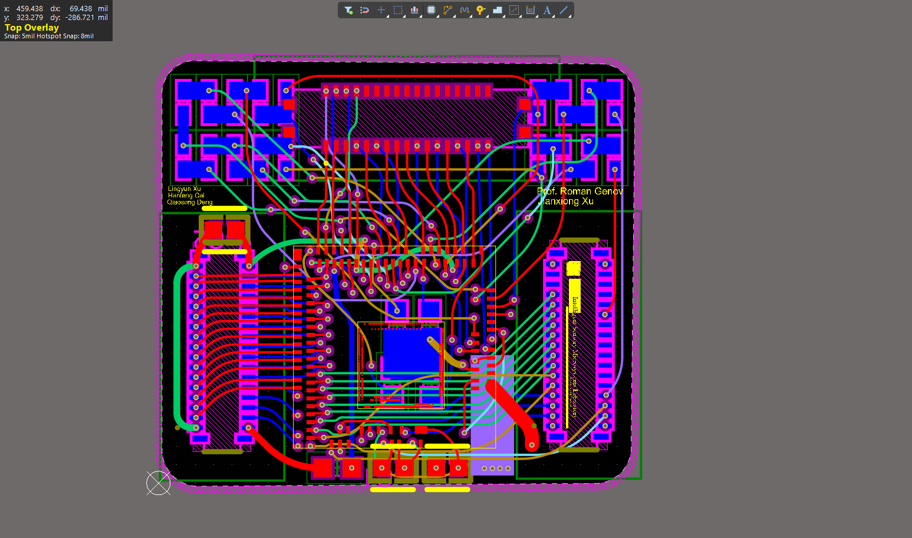
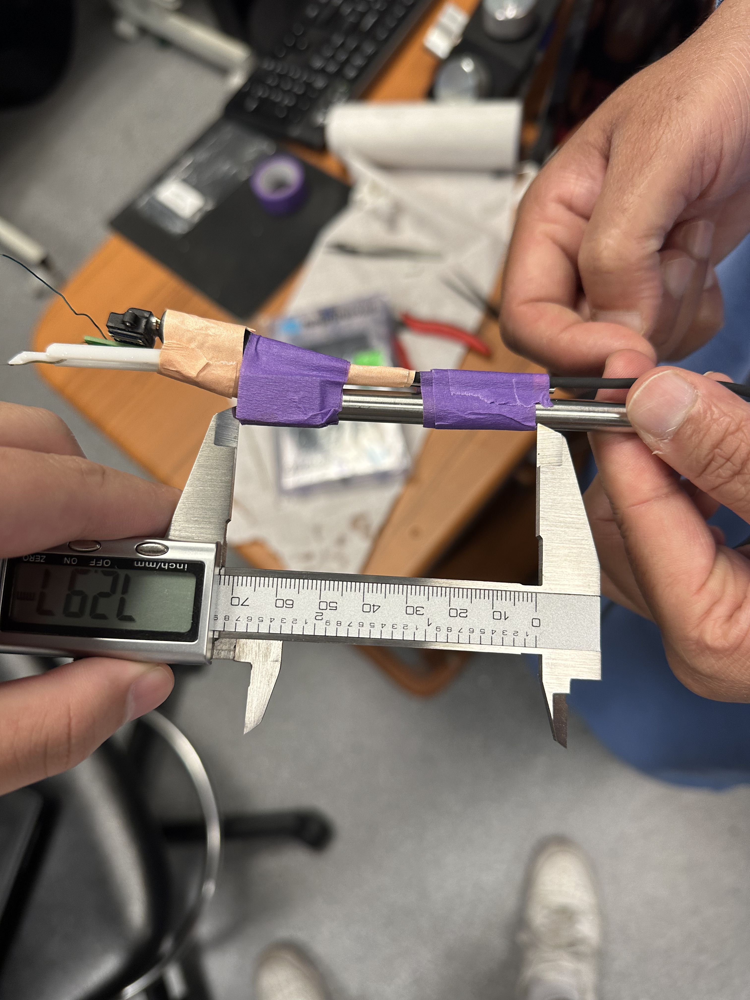
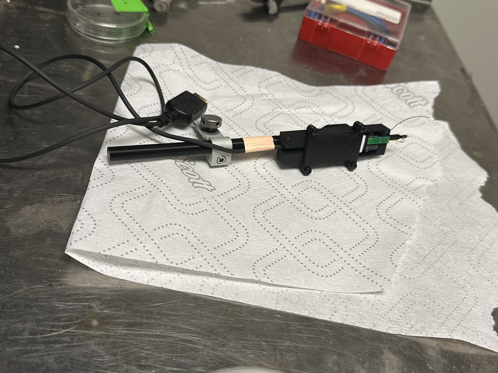
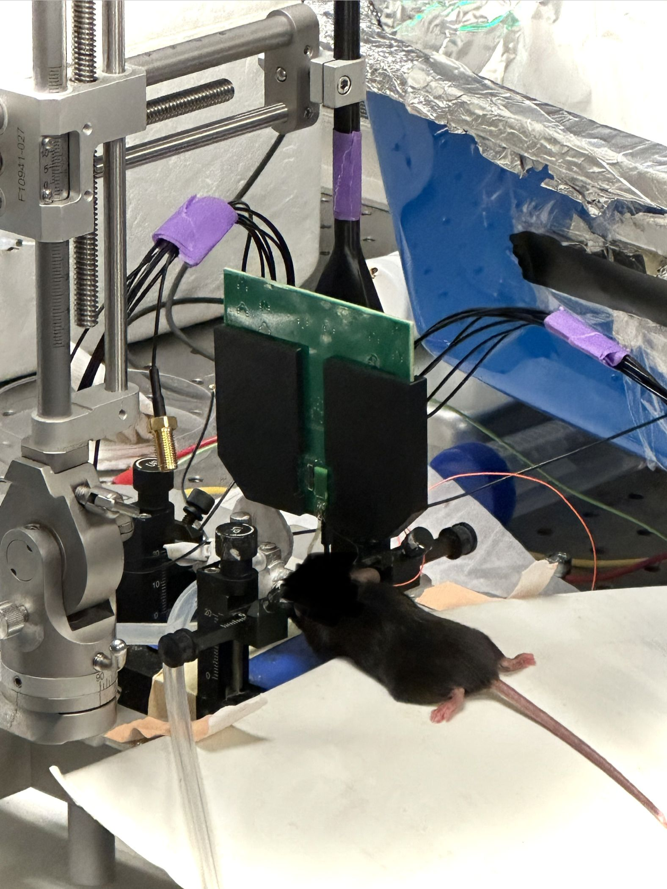

# ISML Project Gallery

A collection of projects I worked on at the Intelligent Sensory Microsystems Laboratory (ISML) at the University of Toronto.

- [Chip-on-board PCB](#chip-on-board-pcb)

- [Amplifier breakout board](#amplifier-breakout-board)
- [Single-ended to differential converter](#single-ended-to-differential-converter)
- [Cuff electrode layout](#cuff-electrode-layout)
- [Probe holder redesign](#probe-holder-redesign)

## Chip-on-Board PCB

I worked on a chip-on-board (COB) PCB for neural interface research. The board provides an interface between the bare die and external test hardware.

*The chip-on-board PCB design for the neural interface project.*

## Amplifier Breakout Board

I designed this board from scratch, from schematic capture through PCB layout. It uses four independently controlled 8:1 analog multiplexers to route eight AC-coupled inputs to four outputs.

### Schematic

*Input coupling and bias, channel selection, and output connections.*

### PCB Layout

*The eight input connectors flank the four multiplexers.*

## Single-Ended to Differential Converter

I completed the final portions of the PCB layout using the existing schematic. The board uses an ADA4945-based stage to convert a single-ended input into a differential output.

### Top-Level Schematic

*Supply regulators and the output common-mode reference feed the converter stage.*

### PCB Layout

*The layout shows the regulator blocks, converter stage, and signal connectors.*

## Cuff Electrode Layout

*Layout view of the cuff electrode design.*

## Probe Holder Redesign

I designed a modified 3D-printed holder for a lab probe. The photos show the original setup, the revised design, and how it was used at the bench.

### Original setup

*The original probe setup before the holder was modified.*

### Modified holder

*The revised holder I designed for the probe setup.*

### In use

*The probe and holder in use during a lab setup.*
